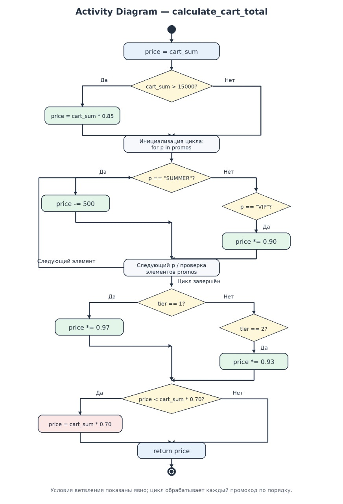

# Итоговый аналитический отчет (Лабораторная работа №1)

## 1. Резюме (Executive Summary)
В ходе лабораторной работы был спроектирован и настроен процесс разработки (CI/CD инфраструктура) для нового микросервиса «Расчет корзины и скидок». Были решены задачи сравнительного анализа хранилищ данных, автоматизировано обеспечение качества кода через линтеры (Quality Gates), проведено обратное проектирование legacy-алгоритма с помощью UML, а также внедрены стандарты проведения Code Review.

## 2. Сравнительный анализ технологий

### 2.1. Матрица принятия решений
Для выбора СУБД под задачи хранения финансовых транзакций, промокодов и бонусных баллов были выбраны две технологии: PostgreSQL и MongoDB.

| Критерий выбора | Вес | Балл PostgreSQL | Взв. PostgreSQL | Балл MongoDB | Взв. MongoDB | Обоснование веса критерия |
| :--- | :---: | :---: | :---: | :---: | :---: | :--- |
| **Поддержка ACID-транзакций** | 0.40 | 5 | 2.00 | 3 | 1.20 | Высший приоритет. Недопустимы потери или дублирование денег/баллов. |
| **Производительность чтения** | 0.20 | 4 | 0.80 | 5 | 1.00 | Высокая скорость расчета корзины при пиковых нагрузках стартапа. |
| **Гибкость схемы данных** | 0.15 | 4 | 0.60 | 5 | 0.75 | Промокоды и правила лояльности могут динамически менять структуру. |
| **Зрелость экосистемы** | 0.15 | 5 | 0.75 | 4 | 0.60 | Наличие готовых интеграций, ORM-решений и инструментов для аудита. |
| **Стоимость владения (TCO)** | 0.10 | 4 | 0.40 | 4 | 0.40 | Доступность open-source версий и специалистов на рынке труда. |
| **ИТОГО** | **1.00**| | **4.55** | | **3.95** | **Победитель: PostgreSQL** |

### 2.2. Расчет и обоснование выбора
Расчет взвешенной оценки производился по формуле: 
\[\text{Рейтинг} = \sum (\text{Вес критерия} \times \text{Балл кандидата})\]

*   **PostgreSQL:** 0.40 × 5 + 0.20 × 4 + 0.15 × 4 + 0.15 × 5 + 0.10 × 4 = 4.55
*   **MongoDB:** 0.40 × 3 + 0.20 × 5 + 0.15 × 5 + 0.15 × 4 + 0.10 × 4 = 3.95

**Обоснование:** Победителем стал **PostgreSQL** с оценкой 4.55. В финтех-модулях критически важна строгая консистентность и ACID-транзакционность на уровне базы данных. В отличие от документоориентированной MongoDB, реляционная СУБД гарантирует отсутствие аномалий при одновременном списании баллов и расчете стоимости.

## 3. Архитектура и контроль версий

### 3.1. Настройка репозитория
В проекте используется GitFlow-подобная модель ветвления. Базовая стабильная линия ведется в ветке `main`, интеграционная ветка для тестирования — `develop`. Все новые функции разрабатываются в изолированных ветках `feature/*`.

*   Ссылка на публичный репозиторий: [https://github.com/sergeevaA736/-lab1-comprehensive-Sergeeva/new/develop]

### 3.2. Контроль доступа
Для ветки `develop` настроено правило Branch Protection, запрещающее прямые коммиты мимо Pull Request. Дополнительно внедрен файл `CODEOWNERS`, требующий обязательного ревью.

*   Содержимое файла `.github/CODEOWNERS`:
    ```text
    * @[sergeevA736]
    ```

## 4. Инструментальный контроль качества

### 4.1. Настройка CI/CD
Для автоматической проверки стандартов кодирования (PEP8) был настроен пайплайн на базе GitHub Actions. Линтер `flake8` с ограничением длины строки в 80 символов запускается на каждый создаваемый Pull Request в ветку `develop`.

*   Ссылка на файл пайплайна: [https://github.com[sergeevA736]
### 4.2. Работа Quality Gate
В ходе тестирования («Сломать и починить») в систему был отправлен код с заведомыми ошибками (неиспользуемый импорт `import os` и строка > 80 символов).
* **Текст ошибки линтера:** `F401 'os' imported but unused` и `E501 line too long (107 > 80 characters)`.
* **Описание исправления:** Из модуля `src/discount.py` был удален неиспользуемый импорт `os`, а длинная строка лога была сокращена/перенесена в соответствии с правилами `.flake8`. При повторном коммите проверка успешно пройдена.

## 5. Обратное проектирование и планирование ревью

### 5.1. Анализ алгоритма
На основе legacy-кода была восстановлена логика последовательности начисления скидок.

* **Визуализация процесса (UML Activity Diagram):**
    

* **Выявленные запахи кода (Code Smells) в legacy-фрагменте:**
    1. **Магические числа (Magic Numbers):** Значения порогов (`15000`), фиксированных скидок (`500`), коэффициентов (`0.85`, `0.90`, `0.93`, `0.97`) и лимита (`0.70`) зашиты жестко в коде. Их необходимо вынести в конфигурацию.
    2. **Жесткое кодирование строк (Hardcoded Strings):** Промокоды `"SUMMER"` и `"VIP"` проверяются строковыми литералами. Появление новых кодов потребует переписывания функции.
    3. **Дублирование вычислений:** Значение минимального порога `cart_sum * 0.70` рассчитывается дважды (в условии и при присвоении).
    4. **Потеря точности (Financial Accuracy):** Использование базовых типов с плавающей точкой (`float`) для финансовых расчетов приводит к накоплению ошибок округления. Требуется переход на `Decimal`.

### 5.2. План code-review
Для модуля внедрен структурированный подход к ревью кода, фокусирующийся на безопасности, защите от фрода при комбинации промокодов и соответствии бизнес-логике.

* Ссылка на открытый Pull Request с планом ревью: [https://github.com/sergeevaA736/-lab1-comprehensive-Sergeeva/pull/3]
* **Ключевые измеримые критерии:** 100% вынос констант, валидация типов входных параметров, тестовое покрытие бизнес-сценариев строго > 80%.
* **Механизм эскалации:** Споры разрешаются путем привлечения команды на технический консилиум, финальное слово остается за Tech Lead / CTO.

## 6. Заключение
Внедренные автоматизированные процессы (Quality Gates) гарантируют, что синтаксически некорректный или не соответствующий стандартам PEP8 код физически не сможет попасть в основную ветку разработки `develop`. Наличие формализованного плана ревью и UML-схем снижает риски логических ошибок в критически важных финансовых модулях расчета скидок, обеспечивая стабильность и безопасность продукта.
